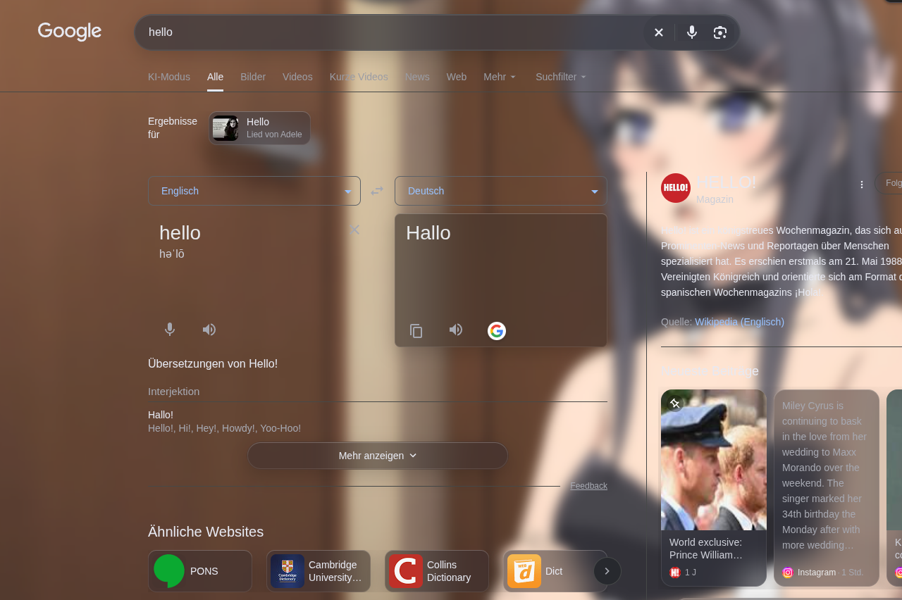
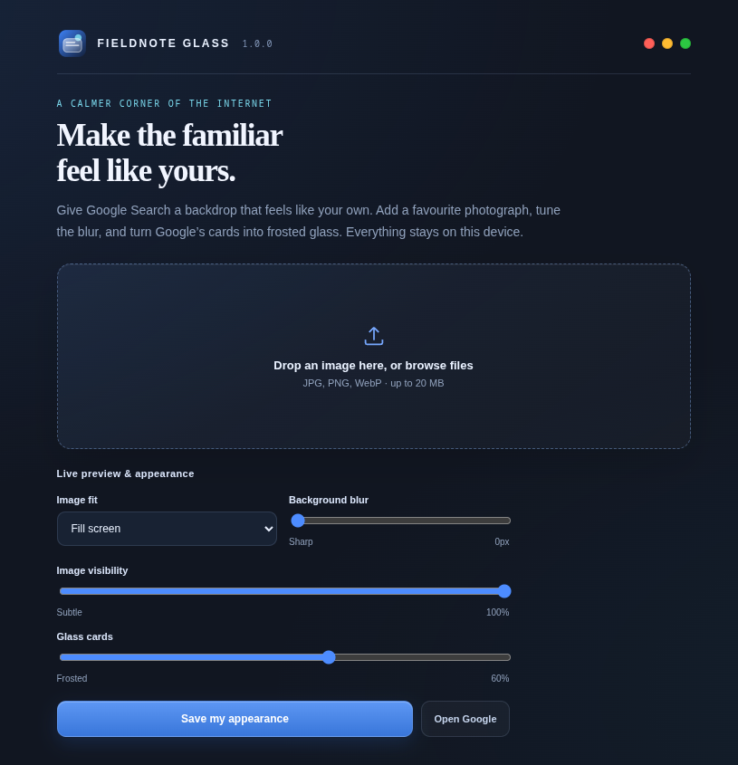
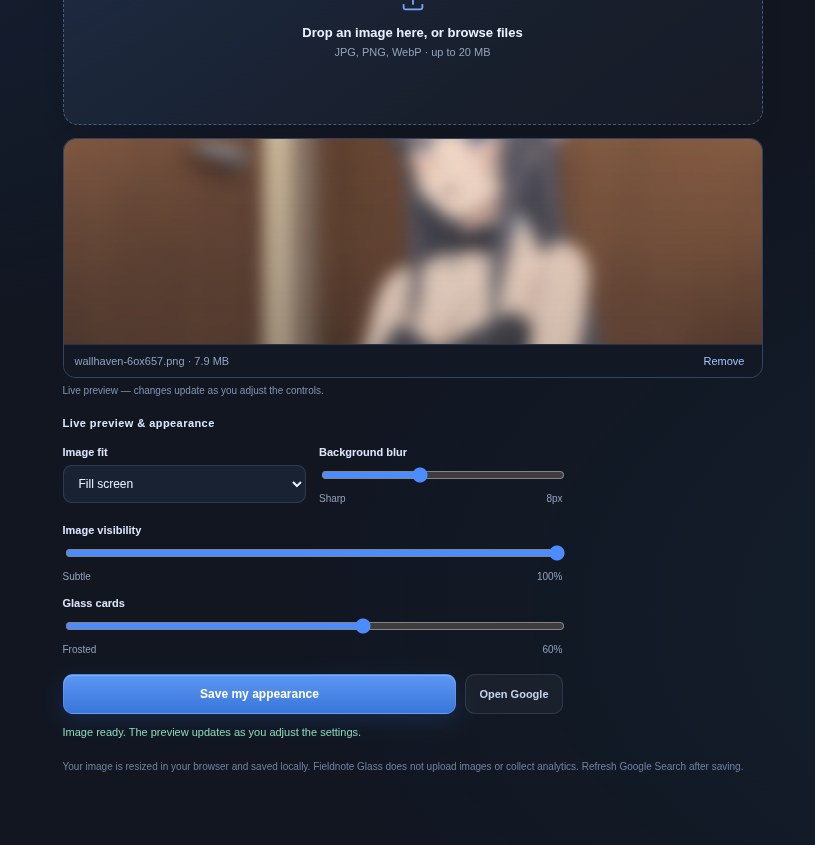

<div align="center">


# Fieldnote Glass

**Your own wallpaper for Google Search, with frosted glass cards.**

[](https://github.com/abgeknallt/fieldnote-glass/releases/latest)
[](LICENSE)


[Download](https://github.com/abgeknallt/fieldnote-glass/releases/latest) · [Install](#install) · [Settings](#settings) · [FAQ](#faq)



</div>

---

## What it does

Fieldnote Glass puts a background image of your choice behind Google Search and turns Google's solid dark panels into translucent, blurred glass. Search fields, answer boxes, knowledge panels, news cards and image-result surfaces all let the wallpaper shine through, while text, layout and functionality stay exactly as Google ships them.

Everything runs locally in your browser. No account, no server, no analytics.

## Highlights

- **Custom background** from any JPG, PNG or WebP (up to 20 MB), resized and compressed in the browser
- **Frosted glass cards** with adjustable strength
- **Live preview** of fit, blur and visibility before you save
- **Three fit modes:** fill screen, fit image, original size
- **Background blur** from 0 to 20 px and **image visibility** from 10 to 100 %
- **Toolbar popup** for quick changes later on
- **Resilient detection:** cards are found by their computed background, not by Google's obfuscated class names, so Google layout updates rarely break it
- **Private by design:** images stay on your device in `chrome.storage.local`

## Screenshots

| Welcome screen | Live preview |
| :---: | :---: |
|  |  |
| Pick an image and tune the controls. | See blur and fit change instantly before saving. |

<div align="center">


*Result page with the glass effect applied to the translation card, knowledge panel and news cards.*
</div>

## Install

Fieldnote Glass is not in the Chrome Web Store yet. Install it as an unpacked extension:

1. Download `fieldnote-glass-v1.0.0.zip` from the [latest release](https://github.com/abgeknallt/fieldnote-glass/releases/latest) and unzip it.
2. Open `brave://extensions` (or `chrome://extensions`).
3. Enable **Developer mode**.
4. Click **Load unpacked** and select the `fieldnote-glass` folder.
5. The welcome screen opens. Choose an image and click **Save my appearance**.
6. Open or refresh [Google Search](https://www.google.com/).

Or from a terminal:

```bash
git clone https://github.com/abgeknallt/fieldnote-glass.git
```

Then use **Load unpacked** on the cloned folder.

### Updating

Download the new release, replace the folder and click the reload icon on the extension card. Your saved image and settings are kept.

## Settings

| Setting | Range | What it does |
| --- | --- | --- |
| **Image fit** | Fill screen, Fit image, Original size | How the picture is placed behind the page |
| **Background blur** | 0 – 20 px | Softens the wallpaper |
| **Image visibility** | 10 – 100 % | Fades the wallpaper toward the page's own colour |
| **Glass cards** | 0 – 100 % | Low values give solid, readable cards. High values give clearer, more transparent glass. Default 60 % |

Changes in the popup apply to open Google tabs right away. Use **Remove** to go back to Google's normal look.

## How it works

1. `content.js` runs on Google Search pages and injects a fixed, blurred background layer behind the page.
2. It scans elements and reads their computed background colour:
   - small and medium opaque panels become **glass** (translucent tint, backdrop blur, soft edge)
   - large layout containers and the sticky bottom bar become **transparent**
   - elements nested inside glass get only a light tint, so surfaces do not stack and darken
3. A `MutationObserver` handles results that load later or while you scroll.
4. Settings and the image live in `chrome.storage.local`. Changes are pushed to open tabs through `storage.onChanged`.

## Supported sites

- `https://www.google.com/*`
- `https://www.google.de/*`

Other Google domains can be added in `manifest.json` under `host_permissions` and `content_scripts.matches`.

## Privacy

- Images are processed in your browser and stored locally with `chrome.storage.local`
- Nothing is uploaded, no analytics, no accounts, no remote code
- Permissions: `storage` and `unlimitedStorage` for your image, `tabs` and `windows` for the welcome page buttons, and host access to Google Search to draw the background

## FAQ

**The background does not show up.**
Refresh the Google tab after saving. Make sure the extension is enabled and that you are on `google.com` or `google.de`.

**A panel is still solid.**
Google changes its markup often. Try raising the *Glass cards* slider and reload the page. If a specific panel stays opaque, please [open an issue](https://github.com/abgeknallt/fieldnote-glass/issues) with a screenshot and the search term.

**Text is hard to read on my image.**
Lower *Glass cards*, add some blur, or reduce *Image visibility*. Darker or calmer wallpapers work best.

**Does it work with light mode?**
Cards keep their own base colour and get a translucent tint, so light mode works too. The extension is tuned primarily for Google's dark theme.

**Does it work in Firefox or Safari?**
Not currently. It targets Brave and Chromium-based browsers (Manifest V3).

**Can I use my own image rights-wise?**
Use images you are allowed to use. The extension never uploads or shares them.

## Project structure

```
fieldnote-glass/
├── manifest.json     Extension manifest (MV3)
├── content.js        Background layer and glass card detection on Google
├── popup.html        Toolbar popup
├── welcome.html      First-run welcome page
├── app.js            Shared UI logic: upload, preview, save
├── welcome.js        Welcome page window buttons
├── background.js     Opens the welcome page on install
├── ui.css            Styles for popup and welcome page
├── brand.svg         Logo
├── icons/            Extension icons
└── docs/screenshots/ README images
```

## Development

Plain HTML, CSS and JavaScript. No build step, no dependencies.

1. Clone the repository and load the folder as an unpacked extension.
2. Edit the files, then click reload on the extension card and refresh Google.

Contributions and bug reports are welcome.

## Changelog

### 1.0.0
- First public release
- Custom background with live preview, fit, blur and visibility controls
- Frosted glass cards with adjustable strength
- Toolbar popup and first-run welcome page

## License

[MIT](LICENSE) © Fieldnote Glass contributors
